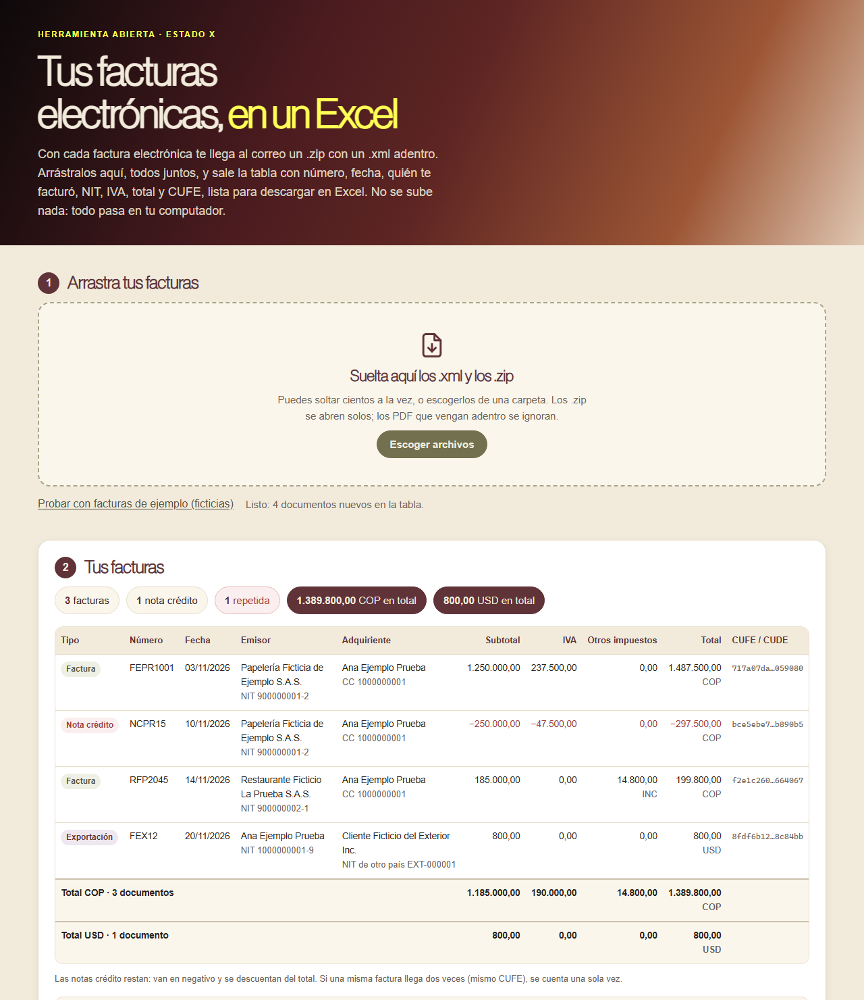

# Tus facturas electrónicas, en un Excel

**[Español](#español) · [English](#english)**

## Español

Herramienta abierta para **pasar a un Excel las facturas electrónicas de la DIAN que te llegan al correo**. Arrastras los .xml y los .zip, todos juntos, y sale una tabla con número, fecha, quién te facturó, NIT, IVA, total y CUFE, lista para tu contabilidad o para tu contador. No se sube nada: todo pasa en tu computador.

**Ábrela aquí:** https://estado-x.github.io/facturas-colombia/

### Qué hace

- **Abre los .zip** que llegan con cada factura y lee el .xml de adentro (los PDF se ignoran). También recibe .xml sueltos. Puedes soltar cientos a la vez.
- **Lee el contenedor de la DIAN** (`AttachedDocument`), que es como llegan casi todas las facturas al correo: la factura va adentro como texto y la página la saca de ahí.
- Entiende **facturas, notas crédito y notas débito**, y marca las facturas de exportación y de contingencia.
- Arma la tabla con estas columnas:

| Columna | De dónde sale en el XML (Anexo Técnico 1.9) |
|---|---|
| Tipo | Raíz del documento (`Invoice`, `CreditNote`, `DebitNote`) y `cbc:InvoiceTypeCode` |
| Número, prefijo y consecutivo | `cbc:ID` y `sts:Prefix` de la numeración autorizada |
| Fecha de emisión | `cbc:IssueDate` |
| Emisor: razón social, NIT y DV | `cac:AccountingSupplierParty` › `cac:PartyTaxScheme` (`cbc:CompanyID`, con el DV en `@schemeID`) |
| Adquiriente: nombre y NIT o cédula | `cac:AccountingCustomerParty` (tipo de documento en `@schemeName`) |
| Subtotal y total | `cbc:LineExtensionAmount` y `cbc:PayableAmount` de `cac:LegalMonetaryTotal` (en notas débito, `cac:RequestedMonetaryTotal`) |
| IVA | `cac:TaxTotal` del documento con tributo `01` |
| Otros impuestos | Los demás `cac:TaxTotal` (INC, ICA y otros), con su nombre |
| Retenciones | `cac:WithholdingTaxTotal` (solo en el Excel) |
| Moneda | `cbc:DocumentCurrencyCode` |
| CUFE / CUDE | `cbc:UUID` |

- **Suma los totales** al pie, separados por moneda. Las notas crédito restan.
- **Avisa** los archivos que no pudo leer (y por qué) y las facturas **repetidas** (mismo CUFE), que cuenta una sola vez.
- **Descarga un Excel (.xlsx)** de verdad, con los valores como números, las fechas como fechas, filtros, totales con fórmula y una hoja de avisos.

Para probarla sin tus facturas, usa «Probar con facturas de ejemplo». Los ejemplos de la carpeta `ejemplos/` son **ficticios**: empresas, personas, NIT y CUFE inventados.

### Cómo funciona

- Es una página estática (HTML, CSS y JavaScript) publicada con GitHub Pages. No tiene servidor ni base de datos, no necesita claves y **no sube tus facturas a ningún lado**. No guarda nada: al cerrar la página, se borra.
- No usa librerías. `assets/zip.js` abre los .zip con el descompresor del navegador (`DecompressionStream`) y arma el .zip del Excel; `assets/facturas.js` lee el XML y saca los datos; `assets/excel.js` arma el .xlsx; `assets/app.js` es la interfaz.
- Las pruebas, en `pruebas/`, revisan cada tipo de documento, el contenedor, los .zip, las repetidas, los archivos dañados, las codificaciones y el Excel.

### Úsala o adáptala

1. Haz un fork de este repositorio.
2. Activa GitHub Pages (Settings → Pages → rama `main`, carpeta raíz).
3. Para probarla en tu computador: `python -m http.server` y abre `http://localhost:8000`. Para correr las pruebas: `node --test pruebas/` (Node 18 o superior, sin instalar nada).

Si quieres otra columna, se saca en `extraer()` de `assets/facturas.js` y se agrega en `COLUMNAS` de `assets/excel.js`.

### Límites

- Lee el XML, que es la factura de verdad. **No lee PDF** ni fotos de facturas en papel.
- No valida la firma digital ni consulta a la DIAN si la factura fue aceptada.
- Muestra lo que dice cada factura: no la clasifica en gastos deducibles ni hace tu declaración. Eso lo revisas con tu contador.
- Si hay facturas en otra moneda, el total se separa por moneda; no se convierten a pesos.
- Los nombres de los campos siguen el Anexo Técnico de Factura Electrónica de Venta, versión 1.9 (Resolución DIAN 000165 de 2023). Si la DIAN publica otra versión, puede haber que ajustar `assets/facturas.js`.

### Crédito

- Inspirada en [invoice2data](https://github.com/invoice-x/invoice2data) de invoice-x (licencia MIT), que saca los datos de facturas en PDF con plantillas. No reutiliza su código: aquí se lee el XML de la factura electrónica colombiana.
- Fuente técnica: Anexo Técnico de Factura Electrónica de Venta, versión 1.9, de la DIAN (adoptado por la Resolución 000165 de 2023, hoy en la Resolución 000227 de 2025).

### Hecho por Estado X

[Estado X](https://estadox.com) · Licencia MIT.

---

## English

An open tool to **turn the Colombian electronic invoices (DIAN) that arrive in your inbox into an Excel file**. Drop the .xml and .zip files, all at once, and get a table with number, date, issuer, tax ID, VAT, total and CUFE.

**Open it here:** https://estado-x.github.io/facturas-colombia/

### What it does

It opens the .zip files, reads the UBL 2.1 XML (invoices, credit notes and debit notes), including the DIAN `AttachedDocument` container that carries the invoice inside, and builds a table with totals per currency (credit notes subtract). It flags unreadable files and duplicates (same CUFE), and downloads a real .xlsx with numbers as numbers and dates as dates. Field names follow DIAN's Technical Annex for electronic sales invoices, version 1.9. The sample files in `ejemplos/` are fictitious.

### How it works

A static page on GitHub Pages: no server, no database, no keys, no libraries, and **your invoices never leave your browser**. Tests: `node --test pruebas/`.

### Limits

It reads the XML, not PDFs. It does not verify digital signatures or check the invoice status with DIAN, and it is not tax advice.

### Credits

Inspired by [invoice2data](https://github.com/invoice-x/invoice2data) by invoice-x (MIT), which extracts data from PDF invoices; no code reused.

### Made by Estado X

[Estado X](https://estadox.com) · MIT License.
